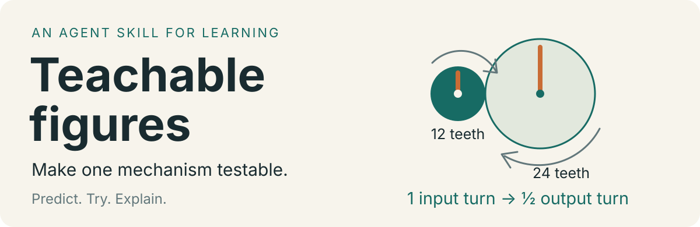
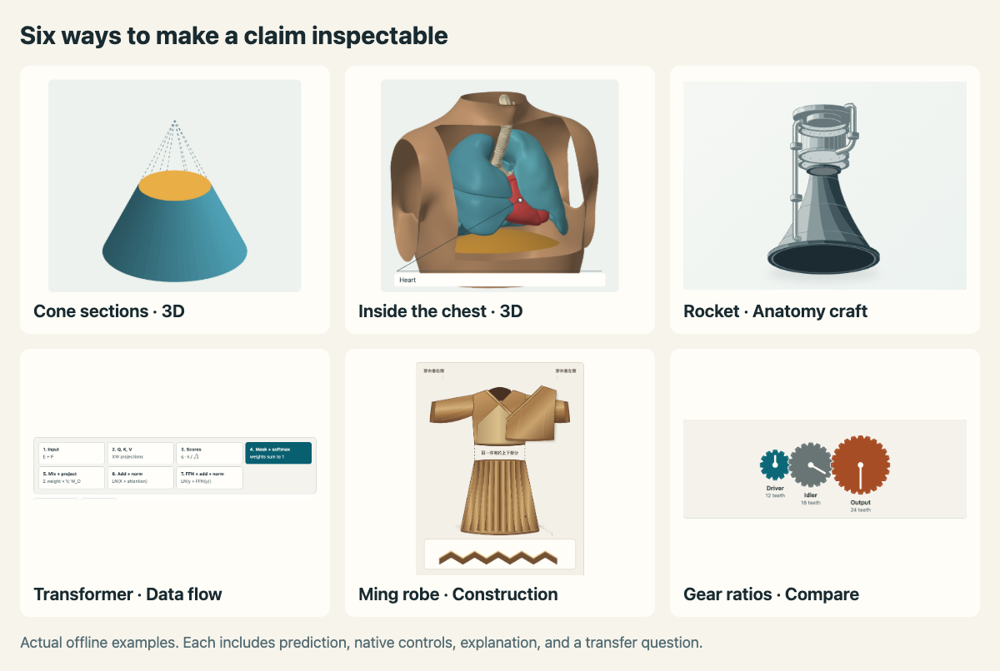
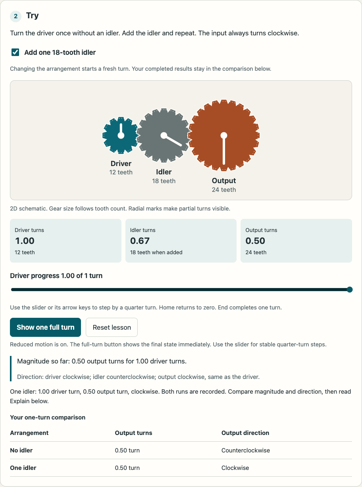

<p align="center">
  
</p>

# Teachable figures

[English](README.md) · [简体中文](README.zh-CN.md) · **[Live demos →](https://ywedai.github.io/teachable-figures/)**

Turn a lesson's claim into an experiment a learner can operate. Predict a result, change a cause, read the effect, and explain a new case.

This is an **agent skill**, with rendering examples and verification tools. It works with a host application's lesson schema or a standalone HTML figure.

## Quick install

**Claude Code** (available in every project):

```sh
git clone https://github.com/ywEdAi/teachable-figures.git ~/.claude/skills/teachable-figures
```

For one project only, clone into that project's `.claude/skills/teachable-figures`. Restart Claude Code, then type `/teachable-figures` or simply describe a teaching task.

**Codex**:

```sh
git clone https://github.com/ywEdAi/teachable-figures.git ~/.codex/skills/teachable-figures
```

Invoke it with `$teachable-figures` in a prompt.

**Other agents or manual install**: download the [repository ZIP](https://github.com/ywEdAi/teachable-figures/archive/refs/heads/main.zip) or the `.skill` file (a ZIP archive) from the [latest release](https://github.com/ywEdAi/teachable-figures/releases/latest) and extract it into the agent's skill directory. If the agent has no skill directory, ask it to read `SKILL.md` first.

To update, run `git pull` in the install directory.

## Two ways to use it

**Guided mode (default).** The skill asks one round of at most five questions, each with a recommended answer you can accept with "ok": who the learner is, the claim and misconception, standalone HTML or an existing app, schematic/detailed/3D fidelity, and the planned controls. It builds after you confirm the plan.

```text
/teachable-figures Explain to middle-school students why an idler gear
does not change the speed-ratio magnitude.
```

**Direct mode.** Say "just build it" or "skip questions", or name the claim, learner, target, and fidelity up front. The skill applies defaults and lists every assumption in its delivery note.

```text
/teachable-figures Just build it. Explain why adding an idler gear does not
change the final speed-ratio magnitude. Misconception: every extra gear makes
the output slower. Standalone HTML with prediction, one-turn counters, native
controls, reset, and an explanation prompt.
```

In Codex, write `$teachable-figures` instead of `/teachable-figures`.

## What it is for, and what it is not for

| Good fit | Poor fit |
| --- | --- |
| A mechanism the learner can **change and observe**: gear ratios, attention masks, cross-section areas | Data charts, dashboards, or report figures with nothing to predict |
| Structures that need cutting, separating, or rotating: a rocket cutaway, chest organs, garment pleats | Slide decks, posters, infographics, or static illustrations |
| One claim from a text, one figure per mechanism | A whole course in one request; pick the mechanisms worth a figure first |
| A teaching model with stated assumptions | Clinical anatomy, engineering simulation, CAD, or physics-engine accuracy; reconstruction presented as historical fact |

A generated figure is a teaching design. It has not been evaluated with learners.

## Explore six complete examples



**[Try all six examples online →](https://ywedai.github.io/teachable-figures/)** No installation required. Each page also runs offline with native controls, reset, an explanation, and a transfer question. Download the [example directory](examples/) for local use.

| Example | What the learner can inspect |
| --- | --- |
| [Cone sections in 3D](https://ywedai.github.io/teachable-figures/geometry-slices.html) | Rotate a cut cone. Compare linear radius growth with quadratic area growth. |
| [Human chest in 3D](https://ywedai.github.io/teachable-figures/human-anatomy.html) | Rotate atlas-sourced human surfaces, open the chest window, and inspect lungs, heart, airways, and a labeled schematic diaphragm. |
| [Rocket launch](https://ywedai.github.io/teachable-figures/rocket-launch.html) | Inspect a crafted rocket cutaway and separate its assemblies; compare thrust, pad support, burnout, and coasting. |
| [Transformer data flow](https://ywedai.github.io/teachable-figures/transformer-flow.html) | Trace toy vectors through Q/K/V, masking, attention, residual normalization, and FFN stages. |
| [A Ming robe](https://ywedai.github.io/teachable-figures/chinese-clothing.html) | Inspect overlapping cloth fronts, shaded fold surfaces, and a pleat section, based on a specific museum garment. |
| [Gear ratios](https://ywedai.github.io/teachable-figures/gear-ratio.html) | Add an idler and distinguish output-turn magnitude from rotation direction. |

The two spatial examples rotate world-coordinate geometry with depth ordering. The chest uses Human Reference Atlas meshes, with a separately authored schematic diaphragm and an inspection window. The rocket is a one-dimensional ideal model, the Transformer uses disclosed toy parameters, and the clothing drawing distinguishes documented facts from reconstruction.

<details>
<summary>See the original gear-ratio teaching loop</summary>

The [gear-ratio lesson](examples/gear-ratio.html) asks whether an extra idler gear makes the output slower. One input turn produces half an output turn with a 12-tooth driver and 24-tooth output. The idler changes direction while preserving that magnitude.



Open the HTML file locally. It runs without a server, framework, or remote assets. The gears are a schematic of an ideal model, not a physical tooth-contact simulation.

</details>

## Start with the mechanism

The teaching spec names a claim, misconception, cause, observable effect, and truth model before geometry. One model drives motion, readouts, accessible summaries, and explanations.

Choose subject representation first, then the simplest renderer that meets the requested fidelity and interaction. [Renderer selection](references/rendering-selection.md) routes iso-figure to functional box-like devices, Anatomy to crafted rigid mechanisms, and organic anatomy/textiles to appropriate source geometry or illustration. The upstream name Anatomy does not imply a medical atlas.

Choose a mode that preserves that representation:

| Mode | Use it for |
| --- | --- |
| 2D SVG | Distributions, curves, state traces, and small processes. |
| Lightweight isometric SVG | Working keys, switches, drawers, and screens. |
| Mechanical SVG | Supports, joints, pipes, cutaways, and exploded assemblies. |
| Turning 3D | Rotation or changing occlusion that explains the concept. |
| Optional WebGL | Fields such as waves, heat, or light that need it. |

Renderer and mechanism are separate choices. A gear ratio does not need a 3D renderer to teach the ratio.

## Review and iteration

The [rendering fusion review](reviews/rendering-fusion-audit.md) explains why the initial examples fell short visually and how v0.3.0 separates subject fidelity from renderer complexity. The [v0.2.0 report](reviews/v0.2.0.md) records the earlier geometry fix and five new lessons. The historical October 27 review includes independent [UI/UX feedback](reviews/uiux.md) and [pedagogical feedback](reviews/pedagogy.md).

The reviewed revision fixes writing-field shortcut interception in both lightweight examples. It adds native controls and live readouts. The synth also gains reset, mute, input ownership, and a scope that stops when idle, hidden, offscreen, or under reduced motion.

The teaching guidance now distinguishes expected probabilities from random samples, defines the meaningful observation, and asks for a causal explanation plus a transfer case. The pedagogy report contains worked temperature-sampling and idler-gear specs.

The four turning-dial crowding defects are repaired through actual socket and terminal geometry. The full configured 3D audit passes with every failure category at zero. Audit thresholds, exclusions, and the rendering engine remain unchanged. [Read the raw full-audit output](reviews/turning-dial-full-audit-v0.2.0.txt).

## Run the checks

The skill and standalone pages have no package runtime dependencies. Node.js is needed for Anatomy builders. Playwright is a development dependency for the browser checks.

```sh
npm ci
npm test
npm run test:browser
```

The v0.3.0 rendering revision passes 4 model/spec checks and 21 browser cases; both new geometry preparation scripts also regenerate their embedded output. The earlier 12 upstream theme builds are recorded in the v0.2.0 review. To run the slower full turning-dial geometry audit in a temporary copy:

```sh
npm run audit:3d
```

The browser suite uses an installed Google Chrome. Set `BROWSER_CHANNEL=chromium` to use a Playwright Chromium installation. Builds run in a temporary copy and leave the bundled source unchanged.

Model tests check the ripple solver and interference behavior. Build tests generate six Anatomy examples in both themes. Browser cases check input isolation, native controls, reset, held-note ownership, the five new lessons, layout at 360px and desktop widths, both color schemes, and reduced motion. See the [current review](reviews/v0.2.0.md) for the exact scope and remaining gaps.

## Know the limits

- Upstream Anatomy examples are rendering demonstrations. Their automatic tours must be disabled before lesson integration. The six complete lessons do not autoplay.
- The AI English Shift adapter describes a particular host. Inspect its current source before relying on paths, registry shape, or language requirements.
- Passing model and browser checks does not establish learning effectiveness. These figures have not been evaluated with novice learners or a screen reader in this review.
- The full mechanical audit covers the configured turning-dial fixture. The cone and atlas chest have their own checks and selected-view inspection, not an exhaustive mesh-intersection proof. A successful build is insufficient evidence of physical accuracy.

## Sources and licenses

This skill fuses the existing **teachable-figures** teaching workflow with two upstream rendering skills. The teaching workflow contributes the claim, misconception, predict → try → explain loop, reusable configuration, and host integration.

| Upstream skill | What this fusion uses | Pinned revision | License |
| --- | --- | --- | --- |
| [Anatomy — wheresryan22/anatomy](https://github.com/wheresryan22/anatomy) | Mechanical solids, joints and pipes, cutaway and exploded views, camera controls, 3D/WebGL techniques, and geometry verification tools. Bundled in `assets/anatomy/`. | [`454a0ef`](https://github.com/wheresryan22/anatomy/tree/454a0ef801b6d9b905f08309d094491c7085b3dd) | [MIT · Ryan](assets/anatomy/LICENSE) |
| [iso-figure — MrBongoC/ai-iso-skill](https://github.com/MrBongoC/ai-iso-skill) | Isometric SVG projection, working keys/switches/displays, shared state and rendering, and portable HTML examples. Bundled in `assets/iso-figure/` and adapted in `references/simple-iso.md`. | [`44b4da7`](https://github.com/MrBongoC/ai-iso-skill/tree/44b4da7714148eef547cc1b102e433472dfe3531) | [MIT · Tolga Cohce](assets/iso-figure/LICENSE) |

Anatomy is the upstream skill's name; it is a toolkit for explanatory objects, not a medical atlas. This fusion adapts upstream defaults to teaching: no mandatory part count, no autoplay before prediction, readable labels, native controls, reduced motion, and a shared truth model. The repository also includes local geometry fixes, accessibility changes, six complete lessons, and review tools.

See [sources and fusion decisions](references/sources-and-fusion.md) for the contribution boundaries and [the source manifest](references/source-manifest.json) for exact revisions and local adaptations. Scientific and historical references for each lesson appear on its example page.

The README design workflow uses [oil-oil/beautify-github-readme](https://github.com/oil-oil/beautify-github-readme). It is documentation tooling, separate from the two bundled rendering skills.

The chest also uses **[Human Reference Atlas / HuBMAP reference meshes](https://humanatlas.io/3d-reference-library)** under [CC BY 4.0](https://creativecommons.org/licenses/by/4.0/). This is a domain data source, separate from the rendering skills. [Asset provenance and alteration details](assets/hra/provenance.json) record the fixed revision, source hashes, cropping, packing and recoloring; [rebuild instructions](assets/hra/README.md) accompany the derivative.

Both upstream contributions retain their MIT notices in [Anatomy's license](assets/anatomy/LICENSE) and [iso-figure's license](assets/iso-figure/LICENSE). Those licenses cover the corresponding contributions. No additional license is granted here for the original lesson material, app references, or screenshots.

## Demo hosting

GitHub Pages serves the `gh-pages` branch. To publish the current `examples/` directory from a clean `main` checkout:

```sh
git subtree push --prefix examples origin gh-pages
```

Pages redeploys when that branch changes. The demos have no runtime package dependencies; `.nojekyll` keeps the published HTML unchanged.
