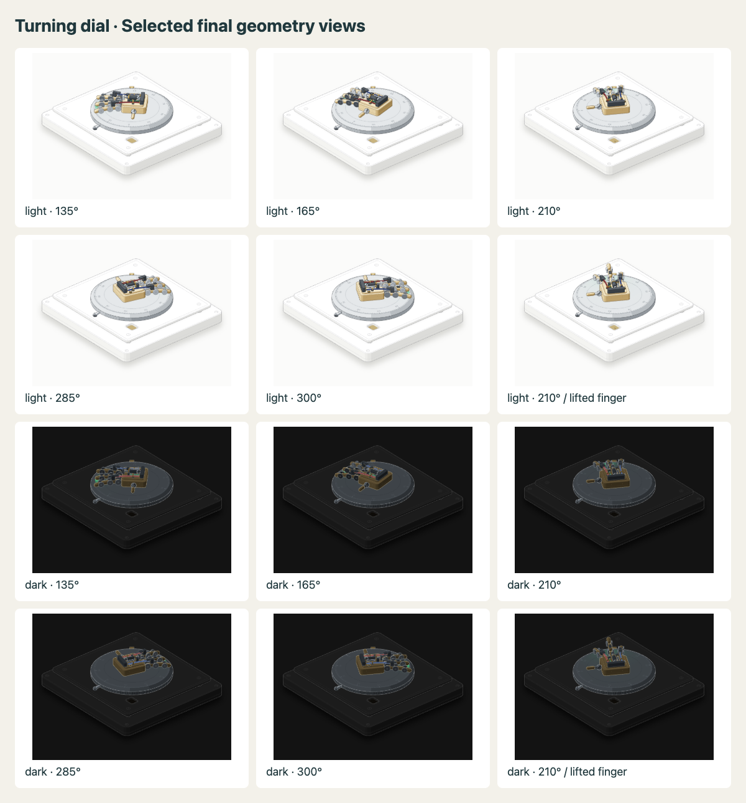

# v0.2.0 iteration

This revision fixes the turning-dial geometry and adds five complete offline lessons. The original v0.1.0 archive, release, and review reports remain available as historical evidence.

## Turning-dial geometry

The parent reran the original quick audit and reproduced the same four crowding findings. Green's terminal was nearly tangent to the third finger and piston rod. Red and blue's final approaches were ambiguous against their proximal finger rods.

The accepted builder change moves the green terminal inward, moves each finger junction forward along its existing support, and adds a small supported roof above each socket. The roofs are actual modeled and drawn solids. The forward junction placement avoids a paint-order cycle through the palm, cover, cable, socket, and root disc. Audit thresholds, exclusions, owners, layer order, and the rendering kit remain unchanged.

Rejected guards cleared crowding but introduced order faults. Those were rejected. A graph trace identified the actual cycle; the audit's suggested thumb/piston split pointed at a blocked descendant. Moving the junction resolved the cause without an engine change.

The final full audit passes with exit status 0 and every failure category at zero. [The raw log](turning-dial-full-audit-v0.2.0.txt) records the command and result. The run uses no `--quick` or `--only` flags. The helper below creates a temporary work copy and propagates the real audit's exit status:

```sh
npm run audit:3d
```

The full audit applies to this turning-dial fixture and its configured sweep, articulated poses, and break-off clip. It is not an exhaustive audit of every renderer or of the new custom educational meshes.

## Five new lessons

| Lesson | Observable claim | Model and limits |
| --- | --- | --- |
| Cone sections | Doubling distance from the apex doubles the radius and quadruples the area. | True rotated 3D triangles; parallel sections of a right circular cone. |
| Chest anatomy | Heart, lungs, and diaphragm retain their anatomical relationships under a change of viewpoint. | True rotated 3D schematic; cited NHLBI relationships, no clinical or physiological simulation. |
| Rocket launch | Initial lift requires sufficient thrust; losing thrust does not instantly cancel upward velocity. | Ideal vertical analytical flight with mass loss, pad support, delayed liftoff, burnout, and coast. No drag, staging, or orbital model. |
| Transformer flow | Causal masking zeros future attention contributions before softmax. | Explicit toy matrices, query selection, Q/K/V, values, projection, residuals, normalization, and FFN. No trained or next-token behavior. |
| Ming robe | Opening a front panel reveals an overlapping panel; separating the drawing does not create two garments. | One museum-documented robe. Flat illustrative construction, not a measured pattern or a universal account of Chinese clothing. |

Every page has prediction, native controls, reset, an explanation prompt, and a transfer question. The [example directory](../examples/index.html) links the five pages and the original gear-ratio lesson. The pages run without remote assets or runtime dependencies.

Author notes describe [geometry and anatomy](geometry-anatomy-notes.md) and [Transformer and clothing](transformer-clothing-notes.md). Primary-source citations are on the relevant pages. The rocket's equations follow NASA Glenn's thrust, thrust-to-weight, and ideal rocket references, with explicitly chosen teaching parameters.

## Independent review and retained regressions

An independent reviewer inspected all five new examples and their sources. The [review](new-examples-review.md) found a cone endpoint with coincident caps and stale feedback after revised predictions. The parent reproduced both defects before fixing them. At the cone's base endpoint, the renderer now emits only one cap. Both prediction handlers now render after saving.

The exact focused browser regressions failed before these edits and passed afterward. The cone regression reads the frontmost visible SVG fill at three points, not only the numerical area. Other cases drive native controls and verify camera invariance, masking, reset, clothing inspection, and the rocket's analytical results against an independent numerical integration.

Run the retained suites with:

```sh
npm ci
npm test
npm run test:browser
```

The browser suite covers 360px and desktop, light and dark themes, reduced motion, page errors, and remote-asset isolation. Screenshots support visual inspection. Model assertions and browser cases establish behavior of these examples; they do not establish learning effectiveness.

## Verification status

- The unchanged baseline quick audit reproduced four crowding failures.
- Targeted final rest/routes and quick order checks pass.
- All 16 model/build checks and 19 browser cases pass against the final source.
- Light and dark snapshots at the former failure angles, a lifted-finger pose, and 360px views render without page errors. Four-times-resolution socket closeups were inspected.
- The full orbit audit passes. It covers 9,015 order states, 3,254 posed states, and 72 depth-oracle states with 20,058 overlapping pairs. All failure categories, including crowding, order cycles, swaps, depth, and continuity, are zero.
- Node fidelity passes, including its planted-error control. The audited builder SHA-256 is `69afd966fd25aaa3f82355b7254aaef1c17ee0b203e018faa0571c761d6ebaf4`, identical to the published source.



## Remaining limits

No learner study, screen-reader session, hardware-touch run, textile-conservation review, exhaustive custom-mesh intersection audit, or clinical anatomical validation is claimed. The human model is intentionally schematic, and the historical drawing labels every reconstructed detail. Existing upstream mechanical demos still require tour and accessibility integration before use as lessons.
